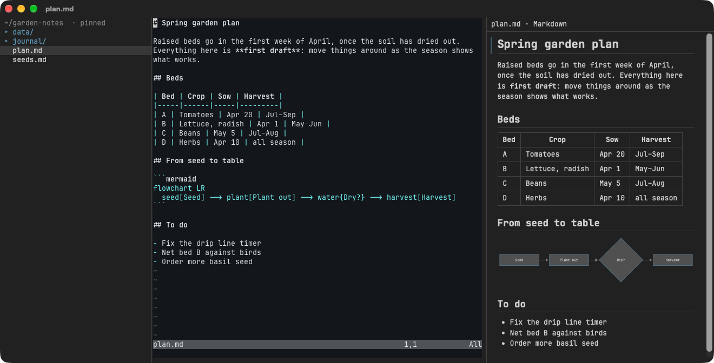
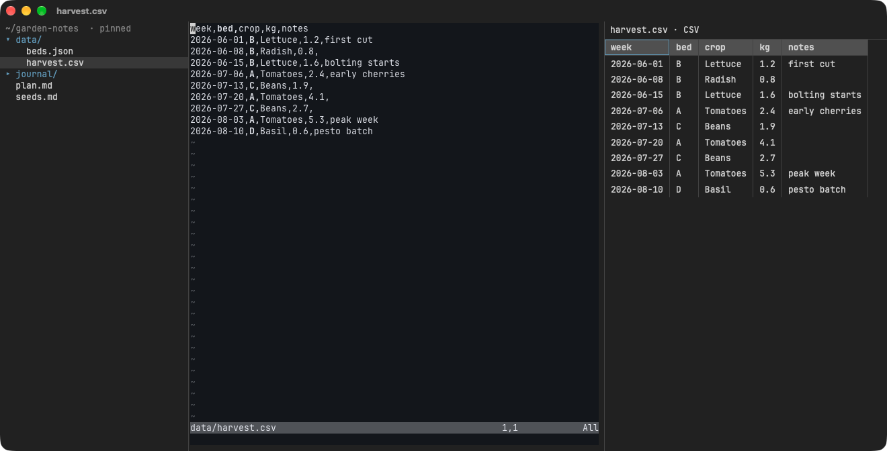
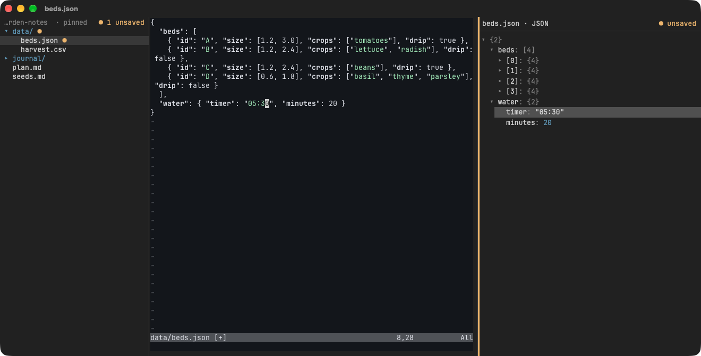

# scwrote

A native macOS editor shell: a Ghostty-rendered window running your nvim.



```bash
scwrote README.md
scwrote ./
scwrote notes/today.md
scwrote --fresh ./
```

`scwrote <files>` behaves like `nvim <files>` typed in the same shell: same
arguments, same working directory, same environment (`PATH` and all). With a
folder, or no argument, it opens a file browser on that folder instead, and the
folder becomes nvim's working directory. The window uses your Ghostty config
(font, theme) and closes when nvim exits. Opening a folder again brings its
window back the way you left it; `--fresh` starts it fresh instead (see
[Coming back to a folder](#coming-back-to-a-folder)).

## Install

```bash
curl -fsSL https://raw.githubusercontent.com/commoncosmo/scwrote/main/install.sh | sh
```

Requires macOS 26 or later and Neovim (`brew install neovim`).

This downloads the latest release, checks it against its checksum, and puts
the command at `~/.local/bin/scwrote` and the app (binary, the resource folder
libghostty loads from beside it, and the bundled ripgrep, `rg`, that project
search runs) in `~/.local/share/scwrote/`. It never uses `sudo`, and if
anything fails your previous install is left as it was.
Make sure `~/.local/bin` is on your `PATH`, then check with `scwrote --version`.

Two variables change what it does:

```bash
curl -fsSL https://raw.githubusercontent.com/commoncosmo/scwrote/main/install.sh | PREFIX="$HOME/opt" sh
curl -fsSL https://raw.githubusercontent.com/commoncosmo/scwrote/main/install.sh | SCWROTE_VERSION=1.2.3 sh
```

`PREFIX` is where to install (default `~/.local`). `SCWROTE_VERSION` is a
release to install, as `X.Y.Z` with no `v` (default: the latest).

To update, run the install line again. To uninstall:

```bash
rm -rf ~/.local/share/scwrote ~/.local/bin/scwrote
```

Updating and uninstalling use the same `PREFIX` as the install (the paths
above are for the default `~/.local`).

Installing with curl doesn't quarantine anything. If you download the archive
in a browser instead, macOS marks it as quarantined, and installing it as it is
would install a quarantined binary. Clear that on the archive, then install
from it:

```bash
xattr -d com.apple.quarantine scwrote-macos.tar.gz
SCWROTE_ARCHIVE=./scwrote-macos.tar.gz sh install.sh
```

To check that a download came from this repository's release build:

```bash
gh attestation verify scwrote-macos.tar.gz --repo commoncosmo/scwrote
```

## File browser

Fills the window when you start on a folder; choosing a file opens it in nvim
and hides the browser. Pinned, it stays beside the editor.

A yellow ● marks every file open in nvim with changes not yet written, and
every folder above one, open or collapsed, so the dots lead you to it. The
header counts them (`● 2 unsaved`), files outside the browser's folder
included. A dot appears with your first change and goes on `:w`, or when you
throw the changes away (`:e!`, `:bd!`). Unnamed buffers aren't counted.

Moving between the browser and the editor works from either pane, the way
Cmd+[ and Cmd+] move between splits in Ghostty and iTerm2. With the preview
shown they move one pane at a time across all three (see Preview below):

| Key | Does |
|---|---|
| Cmd+[ | one pane left; from the editor, the browser, showing it if hidden |
| Cmd+] | one pane right; from the browser, the editor (hides the browser unless pinned) |
| Esc (in the browser) | go to the editor (hides the browser unless pinned) |
| Cmd+1 | show the browser and go to it / go to it / hide it |
| Cmd+Shift+1 | pin / unpin |
| Cmd+, | open Settings (from any pane, an overlay or Settings itself) |

In the browser:

| Key | Does |
|---|---|
| `j` `k`, ↓ ↑ | move (counts work: `5j`) |
| `l`, → | open a folder, step into an open one, open a file |
| `h`, ← | close a folder, or jump to the folder you're in |
| Enter, `o` | open a file, or open/close a folder |
| `gg` `G` | top / bottom (`3G`: third row) |
| Ctrl-d Ctrl-u | half a page down / up |
| `-` | go up a folder |
| `gh` | show / hide dotfiles |
| `a` | add a file or folder |
| `r` | rename the selected item |
| `d` | delete the selected item, after a confirmation |

Files open through nvim's RPC socket (scwrote starts nvim with `--listen`),
using `:edit`. The tree follows changes on disk.

**Empty folders.** An empty folder's row reads `(empty) · a: new file`. Esc
and Cmd+] still go to the editor, where nvim's empty buffer works (`:e
name.md`).

**Add, rename, delete.** `a`, `r` and `d` ask on the browser's bottom row,
like vim's command line. Enter confirms and Esc cancels; while it's open,
keys go to it, and the window's Cmd keys still work (and cancel it). Editing:
typing, Backspace (or Ctrl-h), Forward Delete, ← →, Ctrl-a / Ctrl-e or Home /
End (start / end), Ctrl-w (delete the word, or path part, before the cursor),
Ctrl-u (delete everything before the cursor), Cmd+V (paste the first line).

- `a` reads `New: notes/`: the selected folder, the selected file's folder,
  or the root (`New: ./`). `notes/today.md` makes `notes/` along the way; a
  trailing `/` makes a folder. A new file opens in nvim at once; a new folder
  is selected.
- `r` starts with the current name. A `/` in the new name moves the item,
  but only within the browser's folder (a symlink you made inside the folder
  is followed, though, wherever it leads). If the file is open in nvim, its
  buffer takes the new name and keeps unsaved changes; renaming a folder does
  the same for every open file inside it. `:w` then writes to the new name
  (a buffer that a plugin writes, such as an encrypted file, needs `:w!`
  once).
- `d` asks first: `Delete notes.md? (y/N)`, `Delete folder drafts/ and its
  12 items? (y/N)`, or `notes.md has unsaved changes. Delete anyway? (y/N)`.
  Only `y` deletes; any other key cancels. The item goes to the Trash, and
  nvim closes its buffers, unsaved changes and all.

Nothing is ever overwritten: an existing name shows `notes.md already exists`
on that row, as do other errors (`permission denied`), until the next key.

## Preview

A pane to the right of the editor that shows the file nvim is editing, drawn
from nvim's buffer, so unsaved text shows too. It appears only when you ask
for it, and stays until you hide it.





| Key | Does |
|---|---|
| Cmd+2 | show the preview and go to it / go to it / hide it |
| Cmd+] | move one pane right: browser, editor, preview |
| Cmd+[ | move one pane left: preview, editor, browser |
| Esc (in the preview) | back to the editor |

The window's menu has these too, as Toggle Preview, Move to Left Pane and Move
to Right Pane. The preview has no pin: leaving it doesn't hide it. In a narrow
window the unpinned browser gives way first, then the preview; they come back
when there's room. The pane you're in never gives way, nor does the preview
while you're in the browser: the editor narrows instead, so you can step
through images. Cmd+2 on a preview with no room hides it.

What it shows, by file extension (or nvim's `filetype` when the extension says
nothing):

| Format | Shows | Follows nvim's cursor by |
|---|---|---|
| Markdown (`.md`) | rendered page; ` ```mermaid ` blocks become diagrams | scrolling the block under the cursor into view |
| CSV, TSV (`.csv`, `.tsv`, `.tab`) | a table (first rows only for big files) | highlighting the cursor's row and column |
| JSON, YAML (`.json`, `.jsonc`, `.yaml`, `.yml`) | a collapsible tree | opening and highlighting the cursor's node |
| HTML (`.html`, `.htm`) | the page, as it is | proportional position |
| Mermaid (`.mmd`, `.mermaid`) | the diagram | not at all |
| SVG | the drawing | not at all |
| Images, PDF | the file, view-only | not at all |

Any other file keeps the pane open with "no preview" in the header.

**When it redraws.** On leaving insert mode and after normal-mode changes
(`dd`, `p`, `.`, undo, `:s`), when you switch buffers, and on save. Not while
you type. If the new text doesn't parse (half-finished JSON, a broken
diagram), the last good render stays and the header shows the error.

**The header** names the file and its kind. When the buffer has unsaved
changes it says "● unsaved" and a stripe runs down the pane's left edge; both
clear on `:w`.

**Which file.** The preview follows nvim's current buffer. Pickers, hovers,
help, quickfix and `:terminal` don't count; it keeps the last real file.
Choosing an image or PDF in the file browser shows it in the preview (even if
hidden) while nvim stays where it was, and focus stays in the browser so you
can step through with `j` and Enter. The preview goes back to nvim's buffer
when you return to the editor.

**HTML is static.** Its scripts never run. Relative CSS, images and fonts load
from the file's folder (so do relative images in markdown). Remote images,
CSS, fonts and media don't load: when the page references any, the header
says "remote content blocked · R to load". Press `R` in the preview, click
that note, or choose View > Load Remote Content to load them for that file
until the window closes; other files stay blocked. Markdown never loads remote
images. scwrote's own renderers need no network.

**Links.** A link to a local file opens it in nvim, as the browser would; a
web link opens your default browser.

In the preview:

| Key | Does |
|---|---|
| `j` `k`, ↓ ↑ | scroll (in a tree: move between nodes) |
| Ctrl-d Ctrl-u | half a page down / up |
| `gg` `G` | top / bottom |
| `l`, → / `h`, ← | open / close a tree node |
| Enter, `o` | open / close a tree node |
| `R` | load the HTML file's remote content |
| Esc | back to the editor |

While the preview has focus it stops following nvim's cursor; it picks up
again when you return to the editor.

## Search

Cmd+Shift+F (View > Find in Folder) searches every file in the browser's
folder for what you type, as plain text, ignoring case. An overlay opens over
the panes: the matches as you type, and below them the lines around the
selected one. Enter opens it in nvim at the match, with the query as the `/`
pattern, so `n` and `N` go to the next and previous one.

It searches what ripgrep would, so it skips files your `.gitignore` names
(even outside a git repository, and `.ignore` and `.rgignore` too), hidden
files and folders, and binary files. Unsaved edits in nvim are searched
instead of the file on disk, under the same rules: a file the search would
skip on disk is skipped unsaved too. It stops at 1,000 matching lines, and the
count says "1000+ matches"; type more to narrow it.

| Key | Typing | List |
|---|---|---|
| characters | edit the query | — |
| Cmd+V | paste (line breaks become spaces) | — |
| Ctrl-J / ↓ | next match | next match |
| Ctrl-K / ↑ | previous match | previous match |
| `j` / `k` | (typed) | next / previous |
| Ctrl-D / Ctrl-U | Ctrl-U deletes back to the start | half a page down / up |
| `gg` / `G` | (typed) | first / last |
| `i` or `/` | (typed) | back to typing |
| Enter | open selected | open selected |
| Ctrl-Q | send all to quickfix | send all to quickfix |
| Esc | switch to list | close |
| Cmd+Shift+F | close | close |

Ctrl-Q sends every match to nvim's quickfix list: all of them, not only the
first 1,000, with unsaved edits included as the overlay showed them. The
overlay says "Sending to quickfix…" while it searches again (Esc cancels),
then closes; nvim opens the quickfix window and goes to the first match.
`:cnext` and `:cprev` move through the matches, `:colder` brings back earlier
lists, and this replaces across the files, asking before each change:

```vim
:cfdo %s/oldName/newName/gc | update
```

nvim makes a buffer for each file in the list, so a list spanning tens of
thousands of files can make it pause for a while before the window opens.

A click selects a match, a double-click opens it, and a click outside the
overlay closes it. Reopening brings back the last query, selected, so typing
replaces it. Search needs ripgrep: release installs bundle it; from source,
run `scripts/fetch-ripgrep.sh` or `brew install ripgrep`.

## Quick open

Cmd+Shift+O (View > Quick Open) finds a file in the browser's folder by a few
letters of its name. An overlay like search's opens: the files that match as
you type, best first, and below them the top of the selected one. Enter opens
it in nvim, without changing nvim's search pattern.

Matching is fuzzy: the letters you type must appear in the path in order, not
necessarily together, ignoring case. Matches in the file name beat matches in
its folders (the extension doesn't count as the name), and letters at word
starts (the start of the path, after `/`, `_`, `-`, `.`, `+` or a space, or a
capital in `EditorWindow`) and runs of consecutive letters count most, so
`ewc` puts `EditorWindowController.swift` on top. Typing a file's whole name
puts it above longer names that start the same: `theme` finds `Theme.swift`
before `ThemeTests.swift`. A `/` narrows by folder: `ui/view` wants `ui`,
then a separator, then `view`. Spaces split the query into terms that must
all match, in any order. Files open in nvim rank first among equal matches.

`name:42` opens the file at line 42, and the preview centers on it. With an
empty query the list starts with the other files open in nvim, then the file
you're in, then the ones you opened recently (nvim's history), then the rest
in path order, so `:42` alone opens a recent file at line 42.

It lists what ripgrep would, so files your `.gitignore` names stay out, but
hidden files and folders (such as `.github/`) are listed. Cmd+Shift+. hides or
shows them; the choice is the Show hidden files setting (see
[Settings](#settings)), so it's remembered and every open window follows it.
While they're hidden the count says "hidden off". Unsaved edits in nvim show
in the preview instead of the file on disk; a binary file's preview just says
so.

The keys and the mouse work as in search (see the table above), with
Cmd+Shift+O closing it. Cmd+Shift+F switches to search and Cmd+Shift+O back;
each keeps its own last query. Quick open needs ripgrep too.

## Coming back to a folder

Open a folder you've worked in before and its window comes back as it was when
it closed:

- the window's size and position (moved onto a screen if its own is gone);
- the panes: the browser shown, hidden or pinned, the preview shown or hidden,
  both dividers where you left them, and the keyboard in the pane that had it;
- the browser: its folder, the folders you had open and the selected row;
- nvim: the same files, in the same splits and tabs, each window at its cursor
  and scroll position.

Not kept: unsaved changes (closing a window on a running nvim still loses
them), undo history (unless your nvim keeps it with `'undofile'`), folds, and
search's and quick open's queries.

Starting on a file, `scwrote notes/today.md`, brings back the session of the
folder you're in (the shell's, which is nvim's working directory), with that
file in front. `scwrote --fresh ./` (or `--fresh` with files) skips bringing
anything back for that launch; when that window closes, what it had is saved
as usual and replaces the old session. Turning off Reopen where I left off
(see [Settings](#settings)) makes every launch fresh this way; sessions are
still saved, so turning it back on brings back what the last window had. The
setting is read as a window opens, so changing it doesn't touch windows
already open.

nvim's flags that lay out its own windows, `-d`, `-o`, `-O`, `-p` (with or
without a count, as in `-O3`), `-q` and `-t`, keep that layout: `scwrote -d
a.md b.md` opens the diff as `nvim -d` would, and nvim's side of the session
is neither brought back nor saved for that window (its window side still is).
Other flags, such as `+42`, `-R` or `-c`, apply to the named files over the
session as they would without one.

nvim's side is saved when nvim exits, or when you close the window or quit
while it runs; the window's side is saved when the window closes. Sessions
live in `~/Library/Application Support/scwrote/sessions`, one folder per
project (a folder reached through a symlink shares its session): `window.json`
for the window and `session.vim`, written by nvim's `:mksession`, for nvim.
Nothing is written into the project. Each session's folder is named by a hash
(SHA-256) of the project folder's real path, and its `window.json` names the
project folder (`"folder"`), so this finds the session of a project called
`notes`:

```bash
grep -l notes ~/Library/Application\ Support/scwrote/sessions/*/window.json
```

Delete a session's folder to forget it.

- **Two windows on one folder:** the second gets the window's layout back but
  none of nvim's files (they're open in the first), and it never saves nvim's
  session. Whichever window closes last leaves its layout behind.
- **Your own session manager wins:** if nvim already has a session loaded as
  it starts (`scwrote -S Session.vim`, your config ran `:source` on one, or a
  plugin such as auto-session or persistence.nvim restored one), scwrote
  leaves it alone and doesn't save nvim's side for that window. A plugin that
  restores its session later, after nvim has started, puts it on top of
  scwrote's; scwrote then leaves its saved `session.vim` as it was (as it
  does once you `:source` a session or write one with `:mksession` yourself).
- **Your nvim options always win:** the session holds no options, mappings or
  variables, and the few global options a session file sets anyway are put
  back to yours after it loads.

While nvim's side loads, the editor pane stays blank (for at most 2 seconds),
so nvim appears with your files already in place. A session that fails to
load in part keeps what did load; the error goes to the log.

## Settings

Cmd+, (scwrote > Settings…) opens the Settings window. Switches apply at once;
there's nothing to confirm.

| Setting | Default | Does |
|---|---|---|
| Quick open > Show hidden files | on | quick open lists hidden files and folders; Cmd+Shift+. in quick open changes it too |
| Folders > Reopen where I left off | on | opening a folder brings its window back (see [Coming back to a folder](#coming-back-to-a-folder)); off, every launch is fresh, as with `--fresh` |

They're kept in `~/.config/scwrote/settings.json`, or
`$XDG_CONFIG_HOME/scwrote/settings.json` if `XDG_CONFIG_HOME` is set. There's
no file until you first change a setting. It's plain JSON, written with
sorted keys, so you can read it or edit it by hand:

```json
{
  "folders" : {
    "reopen" : true
  },
  "quickOpen" : {
    "showHiddenFiles" : false
  }
}
```

Every open window follows a change, whether it's made in another window or in
the file by hand. A change from scwrote rewrites only its own key and keeps
everything else in the file as it was; a symlinked file (from a dotfiles repo,
say) stays a symlink and the change goes to the file it points to. A value of
the wrong type counts as that setting's default. Deleting the file puts every
setting back to its default.

If the file doesn't parse (a comment or a trailing comma is enough, since it's
JSON, not JSONC), the settings keep their last good values, or their defaults
at launch, and the reason goes to the log. The Settings window says what's
wrong and its switches are off until the file parses again: scwrote never
writes over a file it can't read. Cmd+Shift+. in quick open still hides or
shows hidden files in that window.

## Debugging

`SCWROTE_DEBUG=1 scwrote README.md` logs libghostty's lifecycle and actions to
`~/Library/Logs/scwrote.log`.

To check the window without touching it, press keys and save a picture:

```bash
SCWROTE_DEBUG_KEYS='G<CR>' SCWROTE_DEBUG_SNAPSHOT=/tmp/shot.png scwrote ./
```

Keys go to the browser; `<CR>` `<Esc>` `<Up>` `<Down>` `<Left>` `<Right>`
`<C-d>` `<C-u>` are named keys. The window's own keys, `<D-1>` (Cmd+1),
`<D-S-1>`, `<D-2>`, `<D-[>`, `<D-]>`, `<D-S-f>`, `<D-S-o>`, `<D-,>` (Settings)
and `<D-w>` (close), quick open's `<D-S-.>` and search's `<C-q>`, are posted
as real key events, so they take the same path through the app as a
keyboard's. While an overlay is open, plain characters,
`<CR>`, `<Esc>`, `<Up>` and `<Down>` go to it. Text in braces goes to nvim
(`nvim_input`, in nvim's key notation), so `{ohello<Esc>}` opens a line, types
"hello" and leaves insert mode.
`SCWROTE_DEBUG_WIDTH=600` sets the window's content width in points first, to
see which panes give way:

```bash
SCWROTE_DEBUG_KEYS='<D-2>{ohello<Esc>}' SCWROTE_DEBUG_SNAPSHOT=/tmp/p.png \
  scwrote README.md
```

`SCWROTE_DEBUG_FULLSCREEN=1` puts the window in full screen first.
`SCWROTE_DEBUG_SETTINGS=1` opens the Settings window first, as Cmd+, would,
so keys and the picture find it open (the picture of it is saved beside the
window's, as `shot-settings.png` for `shot.png`).
`SCWROTE_SESSIONS_DIR=/tmp/sessions` keeps sessions there instead of in
`~/Library/Application Support/scwrote/sessions`, and
`SCWROTE_SETTINGS=/tmp/settings.json` reads and writes settings there instead
of in `~/.config/scwrote/settings.json`, so test runs leave yours alone.

## Known quirks

- macOS only lets a new app take focus while it still descends from the app
  you're typing in. So the launcher waits (up to 5 seconds) until scwrote
  signals it's in front, via SIGUSR1 to `SCWROTE_NOTIFY_PID`, before giving
  the prompt back. If it exited at once, the window would open behind your
  terminal.
- The nvim command is passed through Ghostty's config, not the surface's
  `command` option: libghostty forces `wait-after-command` on for surface
  commands, which would leave the window at "Process exited" after `:q`.
- libghostty-spm layers a default theme over any config unless given an empty
  `TerminalTheme()`; scwrote passes an empty one so your Ghostty theme wins.
- The release binary is universal, but CI only launches its arm64 half. The
  Intel (x86_64) half is built but not launched in CI.
- Cmd+Shift+F and Cmd+Shift+O go by the character the F and O keys type, so
  they work on Dvorak and Colemak. On a layout with no Latin letters, such as
  Cyrillic or Greek, they may not fire. Choose View > Find in Folder or View >
  Quick Open instead.

## Build from source

Requires macOS 26 or later, Xcode 26 or later, Neovim (`brew install neovim`)
and Bun (`brew install oven-sh/bun/bun`).

```bash
scripts/install-from-source.sh                  # test, build, install to ~/.local
PREFIX="$HOME/opt" scripts/install-from-source.sh   # or somewhere else
```

This runs the tests, builds the release archive as version `0.0.0-dev`, and
installs it with `install.sh` (it sets `SCWROTE_ARCHIVE` to the local archive,
so nothing is downloaded). Run it again to update.

The build also fetches a pinned, universal ripgrep (the project search runs it)
and ships it as `share/scwrote/rg`. `sh scripts/fetch-ripgrep.sh` alone puts it
in `.build/ripgrep/`, which is where `swift run` and the tests look for it.

The preview's page is built with Bun and bundled into the app as a resource, so
a fresh clone needs it built before a plain `swift build` or `swift test`:

```bash
cd web && bun install && bun run build
```

Then `bin/scwrote` from the clone runs the latest `swift build -c release`.
The tests:

```bash
swift test                          # the app
cd web && bun test                  # the preview's page
sh scripts/tests/install-test.sh    # the installer
```

## Layout

- `bin/scwrote`: launcher. Runs the app binary directly (not via `open`) so it
  inherits the shell's environment and working directory.
- `install.sh`: the curl installer. Downloads a release and installs the
  launcher and app under `PREFIX`.
- `scripts/`: `build-release.sh` (tests and builds the release archive),
  `fetch-ripgrep.sh` (fetches the pinned universal ripgrep into
  `.build/ripgrep/`), `install-from-source.sh`, `smoke-test.sh` (runs a built binary),
  `preview-licenses.ts` (writes `THIRD_PARTY_LICENSES`) and `tests/` (the
  installer's tests).
- `.github/workflows/`: `test.yml` runs the tests on every push and pull
  request; `release.yml` builds and publishes a release for each version tag.
- `LICENSE`, `THIRD_PARTY_LICENSES`: scwrote's license, and the licenses of
  the third-party code in the app binary (Ghostty and its dependencies, the C
  libraries, the fonts), in the bundled ripgrep (its Rust crates, and PCRE2
  with SLJIT) and in the preview page.
- `Sources/ScwroteCore`: pure logic, unit tested: argument handling, Ghostty
  config loading, finding `nvim` on `PATH`, the file browser and its keys,
  pane show/hide/pin rules, MessagePack and the nvim RPC client (tested
  against a real headless nvim), and project search: the ripgrep runner and
  its JSON reader, the search over the folder and unsaved buffers, and the
  overlay's results, query and keys; and quick open: the folder's file list
  shared with search (`FolderFileList.swift`), the fuzzy matcher
  (`FuzzyMatcher.swift`), the query's `:line` (`QuickOpenQuery.swift`), the
  ranking (`QuickOpenResults.swift`) and nvim's recent files
  (`NvimClient+QuickOpen.swift`).
- `Sources/Scwrote`: the AppKit app: one window per process, hosting a
  libghostty surface ([libghostty-spm](https://github.com/Lakr233/libghostty-spm),
  pinned exactly because libghostty's API isn't stable yet). The search and
  quick open overlays are one view (`ListOverlayView.swift`) drawing either
  kind of row (`OverlayRenderers.swift`), wired into the window by
  `EditorWindowController+Search.swift` and
  `EditorWindowController+QuickOpen.swift`.
- `Sources/Scwrote/Preview/`: the preview pane: header, web views, image and
  PDF views.
- `web/`: the preview's renderer page (TypeScript, built with Bun): markdown,
  tables, trees, mermaid. `bun test` tests it; `bun run build` bundles it into
  the app's resources.
- `docs/icon/scwrote.svg`: the app icon's source.
  `Sources/Scwrote/Resources/AppIcon.png` is rendered from it at 1024×1024 and
  set as the Dock icon at launch.
- `docs/screenshots/`: the images in this README.

## Releasing

Push a tag named `vX.Y.Z`. The Release workflow's build job builds the archive,
installs it into a temporary prefix to check its version, checks that the
installed `share/scwrote/rg` is the pinned ripgrep, and smoke-tests the
installed app. Then, for tags only, its publish job records a build-provenance
attestation and publishes the release with the archive and its checksum. Tag
releases need the repository to be public for the provenance step (the
organization's plan can't attest private repos).

First release, in this order:

1. Merge this branch to `main`.
2. Run the Release workflow by hand on `main` (below) and confirm the smoke
   test passes on the macOS 26 runner.
3. Make the repository public.
4. Tag `v0.1.0` on `main` and push the tag.

The workflow can only be run by hand from the default branch, and the curl
line installs `main`'s `install.sh`, so the tag has to come after the merge.

To try the build without publishing, run the Release workflow by hand
(Actions > Release > Run workflow) and give it a version. That dry run builds
and smoke-tests the archive and never publishes.

## License

MIT, see `LICENSE`. The third-party code in the app binary, in the bundled
ripgrep (`share/scwrote/rg`) and in the preview page has its own licenses,
listed in `THIRD_PARTY_LICENSES` (installed beside the app as
`share/scwrote/THIRD_PARTY_LICENSES`). Only the preview-page section is
generated:

```bash
cd web && bun run licenses
```

The rest of the file is kept by hand: the app binary (Ghostty, its
dependencies, the C libraries, the fonts) and ripgrep (its Rust crates, PCRE2,
SLJIT and the Rust standard library). Recheck the app binary's part whenever
`Package.resolved` changes, and ripgrep's whenever `scripts/fetch-ripgrep.sh`
pins a new version.
